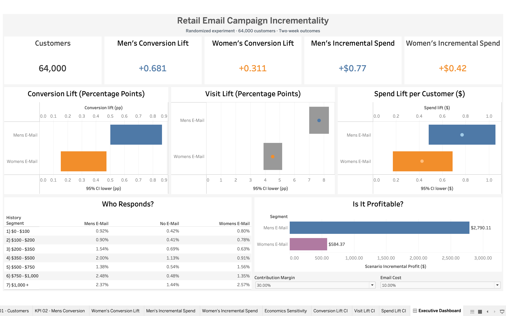

<div align="center">


<br>

<p>
  
  
  
  
  
</p>

<h3>Measuring Marketing Impact, Customer Response & Campaign Economics</h3>

<p>
  <i>
  An end-to-end marketing analytics case study using a 64,000-customer randomized email experiment.
  The analysis estimates incremental visits, conversions, and customer spend, explores heterogeneous response,
  and evaluates campaign economics under explicit cost and contribution-margin assumptions.
  </i>
</p>

</div>

---

## 📊 Executive Dashboard

<p align="center">
  
</p>

<p align="center">
  <strong>Executive view of campaign lift, uncertainty, customer-segment response, and scenario-based profitability.</strong>
</p>

**Tableau Public publication:** Pending. No public dashboard URL is claimed yet. The current Tableau workbook is available at [`dashboard/Retail Email Campaign.twb`](dashboard/Retail%20Email%20Campaign.twb).

---

# 🎯 Business Problem

A retailer randomized 64,000 customers into three groups:

1. **Men's Email** — customers assigned to receive the men's merchandise email.
2. **Women's Email** — customers assigned to receive the women's merchandise email.
3. **No Email** — the randomized control group.

Customer behavior was observed over the following two weeks. The business needs to understand whether either email generated incremental customer activity, which treatment performed better, and whether the estimated lift could justify the cost of sending a campaign.

The project is built around four stakeholder questions:

1. **Did either email increase visits, conversions, and spend relative to the no-email control?**
2. **Which campaign produced the larger average treatment effect?**
3. **Do estimated campaign responses differ across historical-spend segments?**
4. **Under what contribution-margin and email-cost assumptions could a campaign be economically worthwhile?**

The objective is not simply to compare campaign averages. It is to estimate treatment effects, quantify uncertainty, examine customer segments carefully, and translate the findings into a defensible business decision.

---

#  TL;DR — Key Findings

- **Both email treatments improved all three measured outcomes** relative to the randomized No Email control: visit rate, conversion rate, and average spend per randomized customer.
- **Men's Email had the larger observed average lift** across visits (+7.6590 percentage points), conversions (+0.6805 percentage points), and spend (+$0.7698 per customer).
- **Women's Email also showed positive lift:** +4.5233 percentage points in visits, +0.3111 percentage points in conversions, and +$0.4244 in average spend per customer.
- All six planned treatment-versus-control comparisons remained statistically significant after **Holm correction** at a 5% family-wise significance level. The three direct Men's-versus-Women's comparisons also remained significant after their separate Holm adjustment.
- The displayed confidence intervals are **nominal 95% intervals**; they are not simultaneous intervals adjusted for multiple comparisons.
- The uplift-model diagnostics were mixed. They do **not** establish a reliable, deployment-ready individualized targeting policy.
- At an illustrative **30% contribution margin** and **$0.10 email cost per recipient**, estimated incremental profit is approximately **+$2,790 for Men's Email** and **+$584 for Women's Email** for the observed treatment-group sizes. These are scenario estimates, not observed or guaranteed profit.

> **Business takeaway:** Men's Email is the stronger broad-campaign candidate based on the observed experiment outcomes. Confirm actual campaign costs and contribution margin before making a financial deployment decision. Personalized targeting remains exploratory.

---

#  Experiment Design & Dataset

## Dataset source

**Kevin Hillstrom — [The MineThatData E-Mail Analytics and Data Mining Challenge (2008)](https://blog.minethatdata.com/2008/03/minethatdata-e-mail-analytics-and-data.html).**

The source describes a randomized email experiment with 64,000 customers, three experimental arms, pre-treatment customer characteristics, and post-treatment visit, conversion, and spend outcomes over a two-week observation window.

| Experimental arm | Customers | Share of experiment |
|---|---:|---:|
| Men's Email | 21,307 | 33.29% |
| Women's Email | 21,387 | 33.42% |
| No Email (control) | 21,306 | 33.29% |
| **Total** | **64,000** | **100.00%** |

**Data grain:** one row represents one customer-level experimental observation. The supplied table does not contain a customer ID.

## Available fields

| Field | Meaning |
|---|---|
| `recency` | Recency of the customer's prior purchase |
| `history` | Previous-year customer spending |
| `history_segment` | Historical-spend bucket derived from `history` |
| `mens` | Previous men's merchandise purchase indicator |
| `womens` | Previous women's merchandise purchase indicator |
| `zip_code` | Geographic category |
| `newbie` | New-customer indicator |
| `channel` | Customer purchasing channel |
| `segment` | Randomized experimental assignment |
| `visit` | Post-treatment visit indicator |
| `conversion` | Post-treatment conversion indicator |
| `spend` | Post-treatment customer spend in actual dollars |

The analysis preserves the distinction between **pre-treatment customer characteristics** and **post-treatment outcomes**. Historical customer attributes are not randomized, so differences across those attributes should not be described as causal effects of the attributes themselves.

---

# 📈 Overall Campaign Performance

The following rates are calculated within each randomized arm. Spend per customer includes customers with zero spend; it is not restricted to purchasers.

| Metric | Men's Email | Women's Email | No Email (control) |
|---|---:|---:|---:|
| Customers | 21,307 | 21,387 | 21,306 |
| Visit rate | 18.2757% | 15.1400% | 10.6167% |
| Conversion rate | 1.2531% | 0.8837% | 0.5726% |
| Total spend | $30,311.69 | $23,038.11 | $13,908.33 |
| Average spend / customer | $1.4226 | $1.0772 | $0.6528 |

## 1. Incremental visits

| Treatment vs control | Visit-rate lift | Nominal 95% CI |
|---|---:|---:|
| Men's Email | **+7.6590 pp** | +6.9953 to +8.3227 pp |
| Women's Email | **+4.5233 pp** | +3.8894 to +5.1574 pp |

Both treatments increased the probability of a customer visiting during the observation window. Men's Email generated the larger observed visit-rate lift. Visits are an engagement outcome; more visits do not automatically imply profitable purchases.

## 2. Incremental conversions

| Treatment vs control | Conversion-rate lift | Nominal 95% CI |
|---|---:|---:|
| Men's Email | **+0.6805 pp** | +0.5014 to +0.8641 pp |
| Women's Email | **+0.3111 pp** | +0.1502 to +0.4745 pp |

Both conversion confidence intervals are above zero. Men's Email produced the larger observed absolute conversion lift. These differences are **percentage points**, not relative percentage increases.

Conversion comparisons were tested using two-proportion methods. The Holm-adjusted p-values recorded for the conversion comparisons were approximately `6.093e-13` for Men's Email and `4.713e-4` for Women's Email.

## 3. Incremental customer spend

| Treatment vs control | Mean spend lift / customer | 95% bootstrap CI |
|---|---:|---:|
| Men's Email | **+$0.7698** | +$0.4823 to +$1.0545 |
| Women's Email | **+$0.4244** | +$0.1716 to +$0.6878 |

Spend is zero-heavy and right-skewed. The metric is the difference in **mean spend per randomized customer**, including non-buyers with zero spend. Confidence intervals were estimated by customer-level bootstrap resampling with 10,000 resamples and a fixed random seed of 42. The interval values shown here correspond to the latest recorded run; the CSV in `outputs/` is the analytical export used for the Tableau view.

Spend lift is incremental revenue per randomized customer under the dataset's dollar units. It is **not** contribution profit, margin, or campaign ROI.

---

# 🧹 Data Quality & Randomization Checks

Before estimating campaign effects, the analysis audited the supplied data and checked whether the randomized groups were broadly comparable on pre-treatment characteristics.

## Data-quality checks

- Checked missingness, data types, binary fields, business-rule consistency, duplicate rows, and numeric tails.
- No missing values were found in the supplied dataframe.
- Binary variables contained only `0` and `1` values.
- No negative recency, history, or spend values were observed.
- No conversion-without-visit rows or conversion/spend consistency violations were identified.
- `history_segment` was validated as a bucketed representation of `history`; the two should not be treated as independent feature signals without a specific reason.

## Duplicate-row finding

The supplied 12-column table contained **6,562 extra exact duplicate rows beyond the first appearance**, with **7,634 rows** involved in duplicated groups. Because the source does not include a customer identifier, identical records cannot be proven to represent duplicate customers rather than different customers with identical recorded attributes and outcomes. Therefore, the analysis did **not** silently delete these rows.

## Randomization balance

- Numeric and binary pre-treatment covariates were checked using standardized mean differences (SMDs).
- Categorical balance was examined using category proportions and bias-corrected Cramér's V.
- The largest absolute SMD among the checked numeric/binary covariates was **0.008631**, indicating very small observed imbalance.
- Channel and ZIP-category proportions were also close across experimental arms; bias-corrected Cramér's V displayed as `0.000000` to six decimal places.

These checks support the comparability of the observed groups on the measured pre-treatment fields. They do not prove that every possible source of bias is absent.

---

# 🧭 Analytical Approach

The work combines Python-based analysis, DuckDB SQL, statistical inference, Tableau visualization, and an Excel decision calculator.

## 1. Data audit and analysis setup

The customer-level source data was loaded and inspected before analysis. The original records were retained, and data-quality findings were documented rather than silently changing the experiment population.

## 2. DuckDB SQL analysis

SQL was used to create reproducible arm-level and historical-spend segment aggregations.

The current analytical source table is:

```text
customer_experiment
```

The derived arm-level table is:

```text
arm_metrics
```

`arm_metrics` contains one row per experimental arm. SQL source files are maintained in `sql/` and are written for **DuckDB**. Queries can be executed from the Jupyter workflow; running them directly in VS Code is not required.

## 3. Treatment-effect estimation

For each email treatment, outcomes were compared against the randomized No Email control.

- Binary visit and conversion outcomes were summarized as treatment-control rate differences in **percentage points**.
- Newcombe/Wilson two-proportion confidence intervals were used for binary-outcome differences.
- Spend was evaluated as a difference in mean customer-level spend, including zero-spend customers.
- Bootstrap intervals and permutation tests were used for spend inference.
- Six planned treatment-control tests were adjusted together using the Holm procedure.
- The three direct Men's-versus-Women's comparisons were adjusted separately as a three-test family.

The confidence intervals displayed on the dashboard are nominal 95% intervals. Holm adjustment applies to the specified hypothesis tests; it does not transform those nominal intervals into simultaneous confidence intervals.

## 4. Power and minimum detectable effect (MDE)

Power/MDE sensitivity was calculated under both the observed control conversion rate and the 0.9% rate stated in the project brief. These are planning calculations, not observed treatment outcomes. The underlying assumptions and calculations are documented in the analysis and decision workbook.

## 5. Customer-segment analysis

Treatment-control effects were explored across the seven historical-spend segments. These subgroup results are useful for identifying hypotheses about response heterogeneity, but smaller segment sizes and conversion counts can make estimates less precise.

Segment-level findings are exploratory. Do not rank segments solely by point estimates or infer that historical spending causes stronger email response.

---

# 👥 Who Responds? — Historical-Spend Segments

The segment analysis compares each email treatment with the No Email control within the same historical-spend segment.

The Tableau view focuses on conversion lift by historical-spend segment. The detailed Excel decision workbook also contains segment effects and supporting counts.

Interpretation principles:

- Compare treatment and control within each historical-spend segment.
- Retain the correct treatment and control denominators.
- Consider segment sample sizes and conversion counts when interpreting differences.
- Treat subgroup comparisons as exploratory unless supported by a suitable inferential comparison and validation plan.
- Historical spend is a pre-treatment customer characteristic, not a randomized intervention.

The analysis does not claim that a particular historical-spend segment is a proven optimal targeting group.

---

# 💰 Is It Profitable? — Campaign Economics

The dataset contains spend outcomes but does **not** provide campaign email costs or contribution margins. These therefore remain editable business assumptions.

The scenario calculator uses:

```text
Estimated incremental profit
= treatment recipients
  × (
      incremental spend per customer × contribution margin
      − email cost per recipient
    )
```

Where:

- **Treatment recipients** is the observed number assigned to the email arm.
- **Incremental spend per customer** is the estimated treatment-control difference in mean spend.
- **Contribution margin** is an assumed share of incremental revenue retained as contribution.
- **Email cost per recipient** is an assumed campaign cost.

The Excel decision calculator evaluates illustrative contribution margins of **20%, 30%, and 40%**, and email costs of **$0.01, $0.10, and $0.25 per recipient**. These values are scenarios, not supplied business inputs or industry benchmarks.

At a 30% contribution margin and $0.10 email cost per recipient, the estimated incremental profit for the observed treatment-group sizes is approximately:

| Campaign | Estimated incremental profit |
|---|---:|
| Men's Email | **+$2,790** |
| Women's Email | **+$584** |

These estimates are conditional on the selected assumptions. They are not observed profit or a verified forecast. Uncertainty intervals based on spend lift also hold the selected cost and margin assumptions fixed; they do not capture uncertainty in those business inputs. Under the stated scenario, the Women's Email profit interval crosses zero.

Obtain business-approved cost and margin inputs before making a rollout decision.

---

# 🤖 Exploratory Uplift Modeling

A two-model / T-learner logistic-regression baseline was fitted using pre-treatment covariates and evaluated on a 30% holdout.

The purpose was to explore whether customer-level response ranking could add a targeting perspective beyond broad campaign averages. It was not treated as proof of individual-level causal effects.

## Holdout ranking diagnostics

| Treatment / baseline | Custom Qini-style area |
|---|---:|
| Men's Email T-learner | -6.486 |
| Women's Email T-learner | +8.625 |
| Men's Email historical-spend baseline | +12.500 |
| Women's Email historical-spend baseline | +5.149 |

Bootstrap 95% intervals for the T-learner custom Qini-style area:

| T-learner | Bootstrap 95% interval |
|---|---:|
| Men's Email | -22.057 to +8.546 |
| Women's Email | -4.029 to +20.226 |

Both T-learner intervals cross zero. Across three repeated splits, the Men's Email Qini-style area changed sign, while the Women's Email value was positive in all three splits. These are exploratory diagnostics on the same underlying dataset, not independent confirmation.

The metric is labelled **custom Qini-style area** because the implementation is project-specific and should not be treated as a standardized, universally comparable Qini score.

The same holdout was used to compare several targeting fractions. Selecting a policy based on those comparisons risks policy-selection bias. Any proposed targeting policy requires validation on a new independent sample or through a suitable cross-fitting design before deployment.

**Conclusion:** The available uplift results do not establish a reliable individualized targeting policy. The stronger broad-campaign average result for Men's Email should not be confused with proof that Men's Email is optimal for every individual customer.

---

# 📊 Tableau Dashboard

The executive dashboard is organized into three decision layers:

1. **Campaign overview:** five KPIs summarizing experiment size, conversion lift, and spend lift.
2. **Campaign impact:** dot-and-whisker views for conversion, visits, and spend, displaying point estimates and confidence intervals.
3. **Decision support:** historical-spend segment response and an interactive campaign-economics scenario view.

The dashboard uses a restrained visual system with a white background, navy typography, consistent treatment colors, and explicit metric units.

- Men's Email: blue
- Women's Email: orange
- No Email control: gray where shown
- Financial outcomes: restrained positive/negative encoding

The Tableau workbook is currently a `.twb` workbook with file-based data connections. When opening it on another computer, its data sources may need to be reconnected to the local dataset and `outputs/` CSV files. Tableau Public publication is pending; a public URL will be added here only after the dashboard is actually published and verified.

---

# 📘 Excel Decision Workbook

[`reports/retail_email_decision_workbook.xlsx`](reports/retail_email_decision_workbook.xlsx) provides a supporting business-analysis package containing:

- Master experiment scorecard
- Direct Men's-versus-Women's comparisons
- Historical-spend segment effects
- Uplift-policy diagnostics
- Assumption documentation
- Formula-driven economics sensitivity calculator
- Methodological notes and limitations

The workbook complements the Tableau dashboard: Tableau provides the executive visual summary, while Excel provides supporting detail and scenario calculations.

---

# 🧠 What This Project Demonstrates

| Area | Skills demonstrated |
|---|---|
| **Python** | Data inspection, Pandas analysis, statistical workflows, reproducible outputs |
| **SQL** | DuckDB, grouping and aggregation, arm-level metrics, segment analysis |
| **Experimentation** | Randomized treatment/control comparison, treatment effects, power/MDE planning |
| **Statistics** | Two-proportion inference, Newcombe/Wilson intervals, bootstrap, permutation tests, Holm correction |
| **Data Quality** | Missingness, duplicates, business-rule checks, randomization balance, standardized mean differences |
| **Tableau** | Executive dashboard, KPI design, dot-and-whisker confidence intervals, segment views, interactive parameters |
| **Excel** | Decision scorecard, head-to-head comparison, formula-driven financial scenarios |
| **Machine Learning** | Logistic-regression T-learner, holdout evaluation, exploratory uplift ranking diagnostics |
| **Business Thinking** | Campaign prioritization, uncertainty communication, cost/margin trade-offs, limitations-aware recommendations |

---

# 📂 Project Structure

```text
retail-email-campaign-incrementality/
│
├── README.md
│
├── analysis/
│   └── notebooks/
│       └── analysis.ipynb
│
├── dashboard/
│   ├── Retail Email Campaign.twb
│   └── screenshots/
│       └── executive_dashboard.png
│
├── data/
│   ├── README.md
│   ├── GLOSSARY.md
│   └── DECISIONS.md
│
├── outputs/
│   ├── conversion_lift_confidence_intervals.csv
│   ├── visit_lift_confidence_intervals.csv
│   └── spend_lift_confidence_intervals.csv
│
├── reports/
│   └── retail_email_decision_workbook.xlsx
│
└── sql/
    ├── README.md
    ├── 01_data_audit.sql
    ├── 02_randomization_check.sql
    ├── 03_arm_metrics.sql
    ├── 04_segment_metrics.sql
    └── 05_uplift_dataset.sql
```

The original customer-level CSV and local DuckDB database are kept as local inputs and are not required to be committed to the public repository. The source and download information are documented in [`data/README.md`](data/README.md).

---

# 🔁 Reproducibility

## 1. Obtain the dataset

Download the original Hillstrom dataset from the [MineThatData challenge source](https://blog.minethatdata.com/2008/03/minethatdata-e-mail-analytics-and-data.html). Place the CSV in the project's `data/` directory using the original filename:

```text
 data/Kevin_Hillstrom_MineThatData_E-MailAnalytics_DataMiningChallenge_2008.03.20.csv
```

The raw customer-level file is intentionally not included in this repository. See [`data/README.md`](data/README.md) for source and data notes.

## 2. Run the analysis notebook

Open:

```text
analysis/notebooks/analysis.ipynb
```

Use a Python environment with the libraries imported by the notebook installed. A pinned `requirements.txt` is not currently included; package versions should be recorded before treating the environment as fully reproducible.

## 3. Rebuild the DuckDB analytical layer

The SQL source files are in `sql/` and are written for DuckDB. The current customer-level analytical table is `customer_experiment`; `arm_metrics` is the derived table containing one row per experimental arm.

The SQL source remains version-controlled while execution can be performed from Jupyter using the project's DuckDB workflow. The documented query sequence is:

1. `01_data_audit.sql`
2. `02_randomization_check.sql`
3. `03_arm_metrics.sql`
4. `04_segment_metrics.sql`
5. `05_uplift_dataset.sql`

## 4. Refresh statistical outputs

Re-run the statistical calculations in the notebook and refresh the three confidence-interval files in `outputs/` before updating the Tableau dashboard or Excel decision workbook. Keep the fixed bootstrap configuration and recorded output values consistent across deliverables.

## 5. Open the Tableau workbook

Open `dashboard/Retail Email Campaign.twb`. If Tableau reports a missing file connection, use **Edit Connection** to point the source to the local `data/` or `outputs/` file as appropriate. The current `.twb` is not a self-contained packaged workbook.

---

# ⚠️ Limitations & Interpretation

- **Historical experiment:** The data comes from one retailer experiment from 2008, with outcomes observed over two weeks. Results should not automatically be generalized to a current retailer or a different audience.
- **No customer identifier:** The supplied 12-column table does not contain a customer ID. Exact duplicate rows could not be proven to be duplicate customers, so none were deleted.
- **Randomization scope:** Random assignment supports causal interpretation of treatment-versus-control average effects for this experimental population, assuming assignment and outcome measurement were implemented as intended. Customer characteristics themselves were not randomized.
- **Multiple comparisons:** Holm correction was applied to the specified hypothesis-test families. The displayed 95% confidence intervals are nominal, not simultaneous intervals adjusted for multiple comparisons.
- **Subgroup analysis:** Historical-spend segment comparisons are exploratory and are not adjusted for every possible subgroup analysis.
- **Uplift modeling:** Low conversion counts make individual response estimates noisy. The custom Qini-style diagnostics are exploratory and do not validate a deployment-ready targeting policy.
- **Policy selection:** Comparing multiple targeting fractions on the same holdout can create selection bias. Independent validation or cross-fitting is needed before deploying a targeting rule.
- **Campaign economics:** Email costs and contribution margins are assumptions, not observed dataset fields. Scenario outputs are not realized profit or guaranteed forecasts.
- **Dashboard portability:** The `.twb` workbook uses file-based data connections that may need to be repointed on another machine.

---

# 🔗 Source & Attribution

- **Dataset:** Kevin Hillstrom, *The MineThatData E-Mail Analytics and Data Mining Challenge* (2008): [original challenge post](https://blog.minethatdata.com/2008/03/minethatdata-e-mail-analytics-and-data.html).
- **Data interpretation:** The source describes randomized email/control groups and the two-week response window. Monetary spend is recorded in actual dollars.
- **Project work:** Analysis, SQL queries, statistical outputs, dashboard configuration, and the decision workbook were developed for this portfolio case study.

The original dataset remains subject to its source's terms. This repository provides attribution and reproducibility guidance rather than relicensing third-party data.

---

# 👤 Author

<div align="left">

<strong>Syed Abdul Waheed</strong><br />
<em>Data Analyst | Product Analytics | Experimentation | Data Science</em>

<br /><br />

I enjoy turning raw data into clear business decisions — combining SQL analysis, statistical reasoning, dashboards, and predictive methods to understand what changed, how certain the evidence is, and what a business should consider doing next.

<br /><br />

<a href="https://github.com/waheed24-03">
  
</a>

</div>

<br clear="left" />

---

<div align="center">

### ⭐ If you found this project useful, consider starring the repository.

</div>
